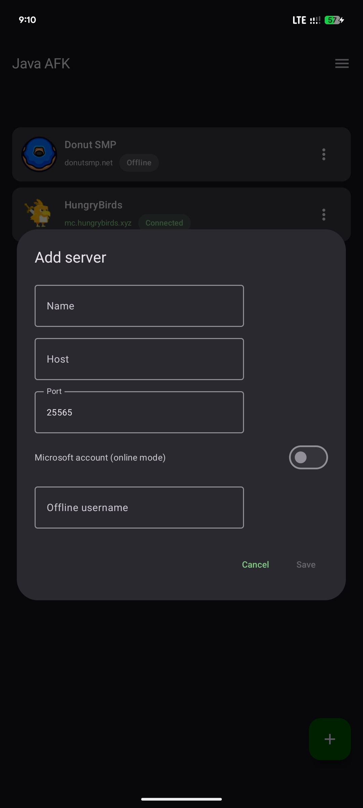
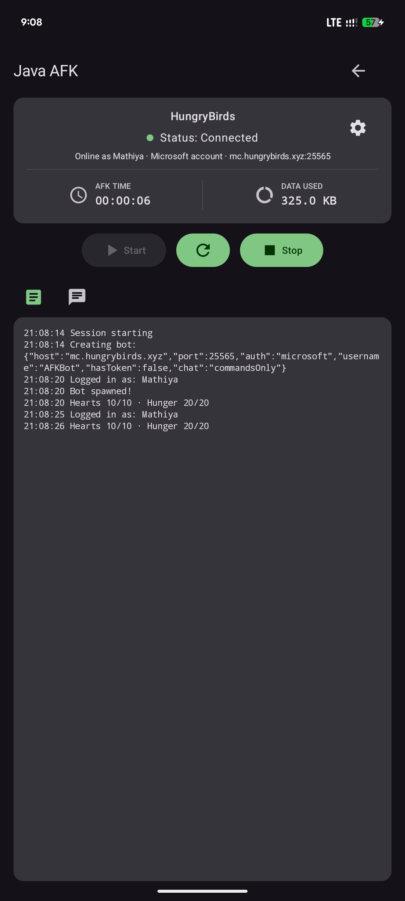

# Java AFK  
**Android Minecraft Java AFK Bot**

## Overview

Java AFK is an Android app that keeps your Minecraft **Java Edition** account online using an embedded Node.js runtime and Mineflayer. It is the full-featured version, built for richer AFK sessions, live logs, chat, and better visibility into what the bot is doing.

## Core Capabilities

- **Mineflayer-based bot engine**
- **Embedded Node.js runtime**
- **Multi-bot sessions**, limited to 5 bots for RAM safety
- **Live logs, chat, and connection states**
- **In-game menu/window visibility**

## Comparison

| | Java AFK | Java AFK NaNo |
| :--- | :--- | :--- |
| **Engine** | Embedded Node.js + Mineflayer | Pure Kotlin |
| **Bot Limit** | 5 bots | No fixed limit |
| **RAM Usage** | Higher | Lower |
| **Data Usage** | Higher | Lower |
| **Best For** | Full-featured AFK sessions | Lightweight long-running AFK |

## Feature Availability

| Feature | Java AFK | Java AFK NaNo |
| :--- | :---: | :---: |
| **In-game menu / window handling** | ✅ | ❌ |
| **Low data usage** | ❌ | ✅ |
| **Low RAM usage** | ❌ | ✅ |
| **No fixed bot limit** | ❌ | ✅ |

> Java AFK limits bots to 5 because Mineflayer uses significantly more RAM and data.  
> Java AFK NaNo is lightweight enough to run without a fixed bot limit.

## Preview

  
  

## Quick Start

1. Install the latest APK from the [Releases](../../releases) page.
2. Add your server.
3. Tap **Start**.
4. Sign in if the server requires Microsoft authentication.
5. The bot connects and stays online.
